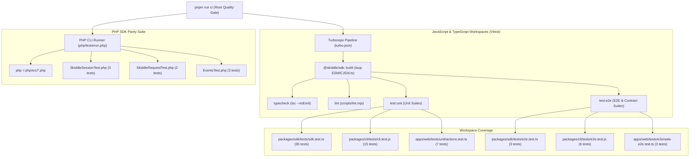

# 04 — Testing & Verification Guide

> **Document Version:** 2.0.0  
> **Scope:** Comprehensive testing architecture, test suites, mocking strategies, static analysis, and verification workflows across `@skiddle/sdk`, `@skiddle/cli`, `apps/web`, and `php/`.

---

## 🎯 Executive Summary

The Skiddle monorepo enforces a **100% network-isolated, deterministic automated test suite** paired with interactive live API diagnostic harnesses. Every workspace in the repository is verified across five distinct layers:

1. **TypeScript Static Verification (`pnpm typecheck`)**: Strict compilation checks (`tsc --noEmit`) across the SDK and Next.js 15 application, plus Node syntax verification across the CLI.
2. **Architectural & Asset Linting (`pnpm lint`)**: Zero-dependency enforcement, strict ES Module `.js` import specifiers, forbidden `debugger` statement checks, and required public PWA asset verification.
3. **Unit Test Suites (`pnpm test:unit`)**: Isolated component, class, parser, and Server Action unit tests using **Vitest**.
4. **End-to-End (E2E) & Contract Suites (`pnpm test:e2e`)**: Multi-step user/developer workflows, retry resilience, dual ESM/CJS bundle export contracts, CLI binary execution, and Next.js Server Action → SDK → eFlyer ViewModel pipelines.
5. **Cross-Language PHP SDK Parity (`pnpm test:php`)**: Zero-dependency PHP syntax validation (`php -l`) and unit tests (`php/tests/run.php`) verifying identical query ergonomics and API v3 pagination translation between PHP and TypeScript.

---

## 🏛 Monorepo Testing Architecture



### Turborepo Task Graph (`turbo.json`)

All test, lint, and typecheck tasks in `turbo.json` declare `"dependsOn": ["^build"]`. When running `pnpm test`, `pnpm test:unit`, or `pnpm test:e2e` from the repository root:
1. Turborepo automatically builds `@skiddle/sdk` first (`dist/index.js`, `dist/index.cjs`, `dist/index.d.ts`) if source files have changed.
2. Downstream workspaces (`@skiddle/cli` and `web`) always test against the fresh `@skiddle/sdk` build artifacts.
3. Results are content-cached by Turborepo (`$TURBO_DEFAULT$`) for sub-second repeat runs.

---

## 🧪 Detailed Breakdown by Workspace

### 1. JavaScript/TypeScript SDK (`packages/sdk/tests/`)

| File | Command | Tests | Responsibilities |
| :--- | :--- | :---: | :--- |
| `tests/sdk.test.ts` | `pnpm --filter @skiddle/sdk test:unit` | **30** | Core classes, error handling, API v1/v3 parameter transformation, fluent condition builder, entity endpoints, and eFlyer ViewModel mapping. |
| `tests/e2e.test.ts` | `pnpm --filter @skiddle/sdk test:e2e` | **3** | Multi-step Search (v3) → Single Detail (v1) → eFlyer workflow, 429 rate-limit retry recovery, and built ESM/CJS/`.d.ts` bundle contract verification. |

#### Key Unit Test Specifications (`packages/sdk/tests/sdk.test.ts`):
- **`SkiddleException`**:
  - Preserves `Error` and `SkiddleException` prototype chains (`instanceof`).
  - Captures HTTP status/error `code` (defaulting to `0`) and structured `details` payloads.
- **`SkiddleSession`**:
  - Initializes with explicit `{ apiKey, devMode }`.
  - Falls back to `process.env.SKIDDLE_API_KEY` when `apiKey` is omitted.
  - Throws `SkiddleException('API Key is missing')` when neither is present.
  - Supports runtime `setDevMode(boolean)` toggling.
- **`SkiddleRequest`**:
  - Switches cleanly between API v1 (`https://www.skiddle.com/api/v1`) and API v3 (`https://api.skiddle.com/v3`).
  - `transformRequestKeys()` renames legacy v1 keys (`api_key` → `apiKey`, `eventcode` → `eventCode` uppercased, `tickets`/`ticketsavailable` → `ticketsAvailable`, `b` → `brandId`, `venueid`/`venueId` → `venueIds`), strips unsupported v3 `order: 'random'`, and translates `limit`/`offset` into 1-indexed `page[size]` and `page[number]` (defaulting `pageSize` to `20` when `offset` is passed alone).
  - Normalizes network transport failures (`DNS lookup failed`), malformed 200 OK JSON bodies, non-JSON 502 HTML gateway errors, API v1 error payloads (`{ error: 1, errormessage }`), and API v3 error payloads (`{ status, detail }`) into `SkiddleException`.
  - Masks API keys (`xxxxxxxxxxxxxxxxxx`) in `getDebugInfo()` traces when `devMode: true` and supports `clearDebugInfo()`.
- **`SkiddleBase`**:
  - Validates session instances in `setSession()` and guards `makeCall()` if no session is attached.
  - Fluent condition builder (`addCond`, `delCond`, `clearCond`, `clearConditions`, `getConditions`) converts array values (`['house', 'techno']`) into comma-separated strings (`'house,techno'`) and returns a shallow clone from `getConditions()` so external mutations cannot corrupt internal query state.
  - Throws `SkiddleException` when calling `delCond()` on a non-existent key.
  - Normalizes legacy event keys in `formatForLog(items, unset)` (`id` → `iListingInstance`, `eventname` → `EventName`, `venue.name` → `Name`, `openingtimes.doorsopen` → `DoorsOpen`).
- **Entities (`Events`, `Artists`, `Venues`) & `createClient()`**:
  - `Events.getListings()` targets `/v3/events/instant-search/`; `Events.getListing(id)` targets `/api/v1/events/{id}/`.
  - `Artists.getListings()` targets `/api/v1/artists/`; `Venues.getListings()` targets `/api/v1/venues/`.
  - `createClient(config)` pre-wires a shared `SkiddleSession` across `events`, `artists`, and `venues`.
- **`toEFlyerPromotionData()`**:
  - Maps `SkiddleEventDetail` into a normalized `EFlyerPromotionData` ViewModel, handling cancelled events (`cancelled: '1'`), fallback hero images (`largeimageurl` → `imageurl`), default accent colors (`#080808`), age restrictions, and opening times.

---

### 2. NX° Developer Experience CLI (`packages/cli/tests/`)

| File | Command | Tests | Responsibilities |
| :--- | :--- | :---: | :--- |
| `tests/cli.test.js` | `pnpm --filter @skiddle/cli test:unit` | **15** | Main menu options, `parseArgs` flag/positional parser, `checkEnv` diagnostics, ANSI terminal styling, 10 classic scenarios, and Git auto-commit generator. |
| `tests/e2e.test.js` | `pnpm --filter @skiddle/cli test:e2e` | **6** | Child-process execution of `bin/nx.js` (`--version`, `--help`), dry-run CI pipeline verification, and mocked E2E runs of `getEventCommand`, `searchEventsCommand`, and `doctorCommand`. |

#### Key CLI Test Specifications:
- **Argument Parsing (`parseArgs`)**: Positional command/subcommand extraction, short flags (`-h`, `-v`, `-i`, `-q`, `-y`, `-k`, `-l`, `-c`), and `--key=value` vs `--key value` forms.
- **Environment Diagnostics (`checkEnv`)**: Node.js version support (`>= 18`), OS platform detection, `pnpm` package manager detection, Git availability, and `SKIDDLE_API_KEY` presence.
- **Conventional Commit Generator (`git.js`)**: `git status --porcelain` line parsing (`M`, `??`, `R`), workspace categorization (`cli`, `php`, `js`, `docs`), and automatic conventional commit title/body generation.
- **E2E Command Execution**: Spawns `node ./packages/cli/bin/nx.js` via `execFileSync` to verify binary entrypoints, tests `runTest()` across all 6 modes (`ci`, `unit`, `e2e`, `php`, `lint`, `build`) in `dryRun` mode, and verifies `doctorCommand` against mocked API v3 and v1 endpoints.

---

### 3. Next.js 15 Web Application (`apps/web/tests/`)

| File | Command | Tests | Responsibilities |
| :--- | :--- | :---: | :--- |
| `tests/unit/actions.test.ts` | `pnpm --filter web test:unit` | **7** | Server Actions (`checkServerConfig`, `executeSkiddleQuery`), blank condition pruning, API key fallback, resource routing, and HTTP status error mapping. |
| `tests/e2e/web-e2e.test.ts` | `pnpm --filter web test:e2e` | **3** | PWA Web App Manifest contract, RootLayout metadata/viewport validation, and full E2E Server Action → `@skiddle/sdk` → `toEFlyerPromotionData` pipeline. |

#### Key Web Application Test Specifications:
- **`checkServerConfig()`**: Accurately reports `{ hasServerApiKey: boolean }` without leaking the secret key string to the browser client.
- **`executeSkiddleQuery()`**:
  - Returns a structured `401` error payload when neither a custom `apiKey` nor `process.env.SKIDDLE_API_KEY` is configured.
  - Strips whitespace-only condition values before invoking `@skiddle/sdk`.
  - Routes `'events'`, `'event-single'` (with default fallback ID `'42616476'`), `'venues'`, and `'artists'` to their respective SDK methods.
  - Catches `SkiddleException` and returns `{ success: false, error, errorCode }` with masked debug telemetry (`apiKey=xxxxxxxxxxxxxxxxxx`).
- **PWA & Layout Contracts**: Verifies `manifest()` icons, standalone display mode, `#080f19`/`#0b0f19` theme colors, and Next.js `metadata`/`viewport` exports.

---

### 4. Official PHP SDK (`php/tests/`)

| File | Command | Tests | Responsibilities |
| :--- | :--- | :---: | :--- |
| `php/tests/SkiddleSessionTest.php` | `pnpm test:php` | **3** | Explicit `api_key` initialization, `SKIDDLE_API_KEY` `getenv()` fallback, and `SkiddleException` when missing. |
| `php/tests/SkiddleRequestTest.php` | `pnpm test:php` | **2** | API version getter/setter (`v1`/`v3`) and `transformRequestKeys()` pagination/parameter translation parity with TypeScript. |
| `php/tests/EventsTest.php` | `pnpm test:php` | **3** | Fluent condition management (`addCond`, `delCond`, `getConditions`, `clearConditions`), array-to-CSV conversion, missing condition exception, and entity session binding. |

The PHP test suite uses a standalone zero-dependency test runner (`php/tests/run.php`) with a built-in `PHPUnit_Framework_TestCase` polyfill so tests can run immediately on any PHP CLI (`php php/tests/run.php`) without requiring Composer vendor downloads, while remaining 100% compatible with PHPUnit (`phpunit php/tests`).

---

## 🎭 Mocking Strategy & Network Isolation

All automated tests run with **zero live network calls**. Two complementary mocking patterns are used:

### Pattern A: Constructor Dependency Injection (Unit Tests)
`SkiddleRequest` accepts an optional `fetchImpl` function in its constructor (`new SkiddleRequest(mockFetch)`), and resource classes (`new Events(request)`) accept a custom `SkiddleRequest`:

```typescript
const mockFetch = vi.fn().mockResolvedValue({
  ok: true,
  status: 200,
  text: async () => JSON.stringify({ error: 0, results: [] }),
  headers: new Headers(),
});

const request = new SkiddleRequest(mockFetch as unknown as typeof fetch);
const events = new Events(request);
```

### Pattern B: Global `fetch` Spying (E2E, CLI, and Next.js Server Action Tests)
For end-to-end tests that exercise `createClient()`, CLI commands, or Next.js Server Actions from the outside in, `vi.spyOn(globalThis, 'fetch')` intercepts native `fetch` calls:

```typescript
const fetchSpy = vi.spyOn(globalThis, 'fetch').mockResolvedValueOnce(
  new Response(JSON.stringify({ error: 0, totalresults: 1, results: [...] }), {
    status: 200,
    headers: { 'Content-Type': 'application/json' },
  })
);
```

Always call `vi.restoreAllMocks()` in `afterEach()` to guarantee test isolation.

---

## 🖥 Interactive & Live Testing Harnesses

In addition to automated Vitest and PHP unit/E2E suites, the repository provides four interactive testing tools for live API verification and benchmarking:

1. **Web Interactive API Testing Component (`apps/web/src/components/ApiTester/`)**:
   - Start with `pnpm dev` and open `http://localhost:3000`.
   - Provides visual preset buttons, dynamic condition chips (`addCond`/`delCond`), custom API key override, eFlyer promotional preview cards, raw JSON inspector, and masked HTTP debug traces.
   - Documented in detail in [`docs/10-interactive-api-testing-component.md`](./10-interactive-api-testing-component.md).
2. **NX° CLI Quality Gate Runner (`pnpm cli test`)**:
   - Run `pnpm cli test -i` for an interactive menu to execute the full CI pipeline, unit tests, E2E tests, PHP tests, typecheck/lint, watch mode, or production build—complete with audio feedback and dry-run support (`--dry-run`).
3. **NX° CLI Classic Scenarios & Doctor (`pnpm cli scenarios` & `pnpm cli doctor`)**:
   - `pnpm cli doctor` verifies environment health and live API v3 + v1 connectivity.
   - `pnpm cli scenarios` executes the 10 classic Skiddle SDK scenarios (Manchester radius search, Club nights, Trending events, Tribute acts, Tickets on sale, Weird Science brand showcase, Thekla Bristol venue, UK Festivals, London Comedy, Glasgow Live Music).
4. **Latency & Concurrency Benchmarking (`pnpm cli benchmark` & `php/demo/loadTest.php`)**:
   - `pnpm cli benchmark --requests=20 --concurrency=5` measures p50/p95/p99 latency and throughput using `@skiddle/sdk`.
   - `php/demo/loadTest.php` provides the PHP SDK load and scenario verification harness.

---

## ⚡ Quick Command Cheat Sheet

| Goal | Command |
| :--- | :--- |
| **Run Full CI Quality Gate (Vercel Parity)** | `pnpm run ci` |
| **Run All JS/TS Tests (Unit + E2E)** | `pnpm test` |
| **Run All Unit Tests** | `pnpm test:unit` |
| **Run All E2E & Contract Tests** | `pnpm test:e2e` |
| **Run All PHP SDK Unit Tests** | `pnpm test:php` |
| **Run Watch Mode** | `pnpm test:watch` |
| **Run Test Coverage** | `pnpm test:coverage` |
| **Run SDK Tests Only** | `pnpm --filter @skiddle/sdk test` |
| **Run CLI Tests Only** | `pnpm --filter @skiddle/cli test` |
| **Run Web App Tests Only** | `pnpm --filter web test` |
| **Run Typechecking Across Monorepo** | `pnpm typecheck` |
| **Run Architectural Linters Across Monorepo** | `pnpm lint` |
| **Run CLI Test Runner (Dry Run)** | `pnpm cli test ci --dry-run` |

---

## 🔗 Related Documentation

- [`docs/10-interactive-api-testing-component.md`](./10-interactive-api-testing-component.md) — Next.js 15 Interactive `ApiTester` Component & Server Actions architecture.
- [`docs/12-tdd-testing-suite-and-ci-cd.md`](./12-tdd-testing-suite-and-ci-cd.md) — Deep-dive TDD reference, test-by-test catalog, custom linter internals, and GitHub Actions CI/CD pipeline.
