# 10 — Interactive API Testing Component & Next.js 15 Integration

> **Document Version:** 1.0.0  
> **Topic:** Design, architecture, and implementation of the interactive `ApiTester` component, Next.js 15 Server Actions integration, real-time SDK condition builder, and multi-view diagnostics.

---

## 🎯 Executive Overview & Strategic Importance

The creation of the **Interactive API Testing Component** (`apps/web/src/components/ApiTester/`) marks an important milestone in the Skiddle developer ecosystem. 

While unit tests (`vitest`) verify isolated functions and the CLI (`nx`) provides terminal diagnostics, a modern software SDK must prove its ergonomics, reliability, and security within a real-world frontend web application. 

```
┌────────────────────────────────────────────────────────────────────────┐
│                        Next.js 15 App Router                           │
│  ┌─────────────────────────┐          ┌─────────────────────────────┐  │
│  │   ApiTester Client      │  RPC     │    Server Actions           │  │
│  │   Component (React 19)  │ ───────> │    (executeSkiddleQuery)    │  │
│  │   - Condition Chips     │          │    - SKIDDLE_API_KEY env    │  │
│  │   - Preset Demonstrator │          │    - Zero CORS limitation   │  │
│  │   - Cards / JSON / Logs │ <─────── │    - Latency telemetry      │  │
│  └─────────────────────────┘          └──────────────┬──────────────┘  │
└──────────────────────────────────────────────────────┼─────────────────┘
                                                       │
                                                       ▼
                                         ┌───────────────────────────┐
                                         │       @skiddle/sdk        │
                                         │  (packages/sdk workspace) │
                                         └─────────────┬─────────────┘
                                                       │ Native fetch
                                        ┌──────────────┴──────────────┐
                                        ▼                             ▼
                            Skiddle API v3                Skiddle API v1
                        (api.skiddle.com/v3)          (www.skiddle.com/api/v1)
```

The API testing component solves five fundamental needs:
1. **End-to-End Verification of Workspace Packaging:** Proves that `@skiddle/sdk` resolves cleanly via `workspace:*` in a production Next.js 15 App Router setup without bundling or ESM/CJS interop issues.
2. **Secure Key Management (Zero Credential Leakage):** Executes all SDK calls via **Next.js Server Actions** (`'use server'`). The client browser never receives raw API keys; private keys remain securely inside the server runtime environment (`process.env.SKIDDLE_API_KEY`), while still allowing developers to override keys for testing.
3. **Bypassing Browser CORS Limitations:** Third-party APIs like `api.skiddle.com` restrict direct browser `fetch` calls through CORS policies. Calling `@skiddle/sdk` server-side completely eliminates CORS issues.
4. **Visualizing Fluent Condition Management:** Direct visual interface for the SDK's query condition methods (`addCond`, `delCond`, `getConditions`, `clearConditions`), demonstrating how parameters like `keyword`, `eventCode`, and `limit` are constructed, validated, and normalized.
5. **Observability & Error Trapping:** Captures latency telemetry, HTTP status codes, structured debug logs (`client.getDebugInfo()`), and handles `SkiddleException` payloads with explicit UI feedback.

---

## 🏛 Component Architecture & Data Flow

The component is split cleanly between a client UI harness and a secure server-side execution pipeline.

```mermaid
sequenceDiagram
    autonumber
    actor Dev as Developer / User
    participant UI as ApiTester (Client Component)
    participant Action as executeSkiddleQuery (Server Action)
    participant SDK as @skiddle/sdk (Workspace Client)
    participant API as Skiddle REST API (v1 / v3)

    Dev->>UI: Selects Preset or modifies Conditions (addCond / delCond)
    Dev->>UI: Clicks "Execute SDK Query"
    UI->>UI: React 19 useTransition (sets isPending spinner)
    UI->>Action: Invokes executeSkiddleQuery({ resource, conditions, singleId, apiKey, devMode })
    
    rect rgb(20, 25, 40)
    Note over Action,SDK: Server-Side Execution (Node.js)
    Action->>Action: Resolves API Key (Override or process.env.SKIDDLE_API_KEY)
    Action->>SDK: createClient({ apiKey, devMode })
    Action->>SDK: Applies conditions: client[resource].addCond(k, v)
    Action->>SDK: Calls client[resource].getListings() or getListing(id)
    SDK->>API: HTTP Request (transformRequestKeys, pagination normalization)
    API-->>SDK: JSON Response or Error Payload
    SDK-->>Action: Resolved Entity Data & Debug Traces
    end

    Action-->>UI: Returns QueryResult { success, data, debugInfo, executionTimeMs }
    UI->>UI: Renders Live Telemetry (Latency, Status, Count)
    UI->>Dev: Displays Cards View, Raw JSON, or Debug Trace
```



---

## 📂 Key Source Code Artifacts

### 1. Server Actions Bridge ([`apps/web/src/app/actions.ts`](file:///Users/milky/My%20Drive/GitHub/skiddle/apps/web/src/app/actions.ts))

The server action abstracts SDK execution and guarantees security:

```typescript
'use server';

import { createClient, SkiddleException } from '@skiddle/sdk';

export interface QueryRequest {
  resource: 'events' | 'event-single' | 'venues' | 'artists';
  conditions: Record<string, string | number | boolean>;
  singleId?: string | number;
  apiKey?: string;
  devMode?: boolean;
}

export interface QueryResult {
  success: boolean;
  data?: any;
  error?: string;
  errorCode?: number;
  conditionsSent?: Record<string, string | number | boolean>;
  debugInfo?: any[];
  executionTimeMs: number;
  resource: string;
}

export async function executeSkiddleQuery(req: QueryRequest): Promise<QueryResult> {
  const startTime = Date.now();
  const apiKey = (req.apiKey && req.apiKey.trim().length > 0)
    ? req.apiKey.trim()
    : (process.env.SKIDDLE_API_KEY || '');

  if (!apiKey) {
    return {
      success: false,
      error: 'Skiddle API Key is not configured...',
      errorCode: 401,
      executionTimeMs: Date.now() - startTime,
      resource: req.resource,
    };
  }

  try {
    const client = createClient({ apiKey, devMode: req.devMode ?? true });
    let data: any;
    let conditionsSent = {};
    let debugInfo = [];

    switch (req.resource) {
      case 'events':
        for (const [key, val] of Object.entries(req.conditions)) {
          if (val) client.events.addCond(key, val);
        }
        conditionsSent = client.events.getConditions();
        data = await client.events.getListings();
        debugInfo = client.events.getDebugInfo();
        break;

      case 'event-single':
        data = await client.events.getListing(req.singleId || 42616476);
        debugInfo = client.events.getDebugInfo();
        break;

      case 'venues':
        for (const [key, val] of Object.entries(req.conditions)) {
          if (val) client.venues.addCond(key, val);
        }
        conditionsSent = client.venues.getConditions();
        data = await client.venues.getListings();
        debugInfo = client.venues.getDebugInfo();
        break;

      case 'artists':
        for (const [key, val] of Object.entries(req.conditions)) {
          if (val) client.artists.addCond(key, val);
        }
        conditionsSent = client.artists.getConditions();
        data = await client.artists.getListings();
        debugInfo = client.artists.getDebugInfo();
        break;
    }

    return {
      success: true,
      data,
      conditionsSent,
      debugInfo,
      executionTimeMs: Date.now() - startTime,
      resource: req.resource,
    };
  } catch (err: any) {
    return {
      success: false,
      error: err.message || 'Unknown error occurred during SDK query execution.',
      errorCode: err instanceof SkiddleException ? err.code : 500,
      executionTimeMs: Date.now() - startTime,
      resource: req.resource,
    };
  }
}
```

### 2. Client Explorer UI ([`apps/web/src/components/ApiTester/ApiTester.tsx`](file:///Users/milky/My%20Drive/GitHub/skiddle/apps/web/src/components/ApiTester/ApiTester.tsx))

The client component provides complete control over query parameters:
- **Interactive Preset Buttons:** One-click shortcuts for representative scenarios:
  - 🎸 **Manchester Live**: Live music in Manchester (`eventCode: LIVE`, `keyword: Manchester`).
  - 🎪 **UK Festivals**: Major festivals search (`eventCode: FEST`, `keyword: Festival`).
  - 🎧 **Creamfields**: Target keyword search with limit.
  - 🏛️ **Event ID #42616476**: Stoller Hall Manchester single listing inspection.
  - 📍 **Manchester Venues**: Venue directory search (`client.venues`).
  - 🎤 **Artists Search**: Artist listing search (`client.artists`).
  - ⚠️ **Test Error Handling**: Deliberately executes queries with invalid credentials to verify `SkiddleException` catching in the UI.
- **Fluent Condition Chips:** Visual tags displaying active conditions with instant `×` deletion buttons (mirroring `delCond(key)`) and "Clear All" (mirroring `clearConditions()`).
- **Dynamic Condition Form:** Allows testing arbitrary query parameters (e.g., `radius`, `latitude`, `longitude`, `minDate`).
- **React 19 `useTransition` Hook:** Non-blocking query executions with loading spinner feedback.

---

## 🔍 Tri-Mode Inspection Views

The testing component offers three distinct modes for evaluating query responses:

### 1. Cards View (Presentation Layer)
Renders a responsive CSS grid of cards showing:
- Lazy-loaded high-resolution imagery with fallback placeholders.
- Event title, venue name, and city location tags.
- Formatted dates and verified entry pricing tags.
- HTML-sanitized event descriptions.
- Deep links pointing directly to the event on Skiddle.com.

### 2. Raw JSON View (Contract & Schema Inspection)
Displays the full, unmodified JSON payload returned by Skiddle's API with:
- Formatted indentation (2-space JSON).
- One-click **Copy JSON Payload** button with clipboard confirmation.
- Direct verification of API v3 structure (`data[]`, `meta.totalEvents`) vs API v1 structure (`results[]`, `totalcount`).

### 3. SDK Debug Trace View (Observability Layer)
Exposes the internal execution log recorded by `client.getDebugInfo()`:
- HTTP Method (`GET`) and HTTP Status (`200 OK`).
- Exact duration per request in milliseconds (`durationMs`).
- Sanitized request URL with masked credentials (`api_key=xxxxxxxxxxxxxxxxxxxx`).

---

## 🛡️ Edge Cases & Error Handling Verification

The testing component was designed to handle and demonstrate all real-world failure modes:

| Scenario | Component Behavior |
| :--- | :--- |
| **No API Key Configured** | Detects empty credentials immediately on the server action; returns HTTP 401 with explicit instructions to configure `SKIDDLE_API_KEY` or input a key. |
| **Invalid API Key Supplied** | Traps `SkiddleException` from the SDK; displays high-visibility red error banner showing HTTP code (`403` or `401`), error message, and execution duration. |
| **Zero Search Results** | Renders clear empty-state card indicating no records matched the condition criteria without crashing or throwing null reference errors. |
| **Broken Image Links** | `onError` image handlers automatically switch failing CDNs or broken remote URLs to an aesthetic category icon placeholder (`🎵`, `🏛️`, `🎤`). |
| **HTML Entities in Descriptions** | Automatically strips unescaped HTML tags (`<p>`, `<b>`, `&amp;`) before rendering text to prevent broken layouts. |

---

## 🚀 Verification in Monorepo Pipeline

The component participates in the Turborepo compilation pipeline and passes all strict type checks and production builds:

```bash
# Verify TypeScript typing across apps/web and packages/sdk
pnpm --filter web typecheck

# Verify Next.js production compilation
pnpm --filter web build
```

Both tests pass with zero warnings, confirming zero runtime friction and strict type safety across the monorepo boundary.
