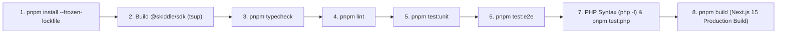

# 12 — TDD Testing Suite, E2E Contracts & GitHub Actions CI/CD

> **Document Version:** 2.0.0  
> **Scope:** Exhaustive technical reference for Test-Driven Development (TDD) workflows, complete test case catalog (72 automated tests: 64 Vitest + 8 PHP across 7 test suites), custom architectural linters, and GitHub Actions / Vercel CI/CD parity.

---

## 1. TDD Philosophy & Red-Green-Refactor Workflow

Every feature, endpoint, and bugfix across the Skiddle monorepo is developed using a strict **Red → Green → Refactor** cycle:

1. **Red (Specify the Contract)**: Write a deterministic failing unit or E2E test in Vitest (`packages/sdk`, `packages/cli`, `apps/web`) or PHP (`php/tests/`) that defines the exact input/output contract, query transformation, or error behavior.
2. **Green (Minimal Implementation)**: Implement the minimal, zero-dependency code necessary to satisfy the test contract without breaking existing suites.
3. **Refactor & Gate (`pnpm run ci`)**: Refine TypeScript types, ensure parity between the JS/TS and PHP SDKs, and run the full quality gate (`typecheck` → `lint` → `test` → `test:php` → `build`).

---

## 2. Complete Test Suite Catalog (72 Automated Tests)

### 2.1 `@skiddle/sdk` Unit Test Suite (`packages/sdk/tests/sdk.test.ts` — 30 Tests)

| Suite (`describe`) | Test Case (`it`) | What It Verifies |
| :--- | :--- | :--- |
| **`SkiddleException`** | `constructs with message, code, details, and preserves instanceof chain` | Verifies `err instanceof Error`, `err instanceof SkiddleException`, `err.name === 'SkiddleException'`, `err.code === 401`, and structured `err.details`. |
| **`SkiddleException`** | `defaults code to 0 when omitted` | Ensures `new SkiddleException('Validation error')` sets `code = 0` and `details = undefined`. |
| **`SkiddleSession`** | `initializes successfully with an explicit apiKey` | Confirms `getApiKey()` and `isDevMode()` reflect constructor options `{ apiKey, devMode }`. |
| **`SkiddleSession`** | `falls back to SKIDDLE_API_KEY environment variable when no key is passed` | Confirms automatic lookup of `process.env.SKIDDLE_API_KEY` when instantiated with no arguments. |
| **`SkiddleSession`** | `throws a SkiddleException when no API key is provided` | Confirms `API Key is missing` exception when both constructor config and `process.env.SKIDDLE_API_KEY` are empty. |
| **`SkiddleSession`** | `allows toggling devMode` | Verifies `session.setDevMode(true)` updates `session.isDevMode()`. |
| **`SkiddleRequest`** | `gets and sets apiVersion accurately` | Defaults to API v1 (`1`) and updates to API v3 (`3`) via `setApiVersion(3)`. |
| **`SkiddleRequest`** | `correctly renames keys and translates deprecated limit/offset for API v3 in transformRequestKeys` | Verifies `api_key` → `apiKey`, `limit: 10, offset: 20` → `'page[size]': 10, 'page[number]': 3`, `eventcode: 'fest'` → `eventCode: 'FEST'`, `ticketsavailable` → `ticketsAvailable`, `b` → `brandId`, `venueid` → `venueIds`, and removal of `order: 'random'`. |
| **`SkiddleRequest`** | `uses default pageSize of 20 when offset is provided without limit in transformRequestKeys` | Verifies `offset: 40` without `limit` computes `'page[number]': 3` (`Math.floor(40 / 20) + 1`), `tickets` → `ticketsAvailable`, `venueId` → `venueIds`. |
| **`SkiddleRequest`** | `constructs v3 endpoint and headers when apiVersion is 3` | Verifies requests when `apiVersion === 3` target `https://api.skiddle.com/v3/events/instant-search/` with transformed v3 query parameters. |
| **`SkiddleRequest`** | `throws SkiddleException when endpoint is empty` | Rejects `request.call('')` with `API Endpoint not set`. |
| **`SkiddleRequest`** | `throws SkiddleException when native fetch fails with network transport error` | Wraps rejected `fetch` promises (e.g., DNS failure) into `SkiddleException('Network transport error: ...')`. |
| **`SkiddleRequest`** | `parses API v1 error format properly` | Extracts `errormessage` from v1 error responses (`{ error: 1, errormessage }`). |
| **`SkiddleRequest`** | `parses API v3 error format properly` | Extracts `detail` from v3 problem responses (`{ status: 404, detail }`). |
| **`SkiddleRequest`** | `handles non-JSON upstream error responses gracefully` | Formats raw HTML/text bodies (`502 Bad Gateway`) into `An unknown error occurred - <body> - <status>`. |
| **`SkiddleRequest`** | `throws SkiddleException when 200 OK body is malformed JSON` | Rejects invalid JSON on 200 OK responses with `Error parsing server response`. |
| **`SkiddleRequest`** | `masks API key in debug logs when devMode is true and supports clearDebugInfo` | Replaces the raw API key with `xxxxxxxxxxxxxxxxxx` in `getDebugInfo()[0].url` and empties trace history on `clearDebugInfo()`. |
| **`SkiddleBase & Conditions`** | `validates session in setSession and propagates devMode` | Rejects `null` or invalid objects in `setSession()` with `Skiddle API Session not set correctly` and propagates `devMode` to the underlying `SkiddleRequest`. |
| **`SkiddleBase & Conditions`** | `throws when makeCall is invoked before setSession` | Rejects `events.getListings()` with `Skiddle API Session not set` when called without a session. |
| **`SkiddleBase & Conditions`** | `manages query conditions fluently and returns isolated copy in getConditions` | Verifies method chaining, array-to-CSV joining (`['house', 'techno']` → `'house,techno'`), defensive cloning in `getConditions()`, `delCond()`, `clearCond()`, and `clearConditions()`. |
| **`SkiddleBase & Conditions`** | `throws an exception when trying to delete a non-existent condition` | Rejects `delCond('non_existent')` with `Trying to delete condition non_existent, but condition not found`. |
| **`SkiddleBase & Conditions`** | `uppercases eventCode and eventcode quirks automatically` | Ensures lowercase `eventcode: 'live_music'` is sent as `eventCode=LIVE_MUSIC`. |
| **`SkiddleBase & Conditions`** | `normalizes legacy keys in formatForLog with unset=false and unset=true` | Maps `id` → `iListingInstance`, `eventname` → `EventName`, `entryprice` → `EntryPrice`, `venue.name` → `Name`, `venue.town` → `Town`, `openingtimes.doorsopen` → `DoorsOpen`, optionally unsetting original keys when `unset=true`. |
| **`Entities`** | `fetches single event by id via Events.getListing on API v1` | Verifies `events.getListing('4040')` hits `https://www.skiddle.com/api/v1/events/4040/` even though `Events.getListings()` uses API v3. |
| **`Entities`** | `fetches artists via Artists.getListings on API v1` | Verifies `artists.getListings()` calls `/api/v1/artists/` with configured conditions. |
| **`Entities`** | `fetches venues via Venues.getListings on API v1` | Verifies `venues.getListings()` calls `/api/v1/venues/` with configured conditions. |
| **`Entities`** | `works seamlessly with createClient helper` | Verifies `createClient({ apiKey })` returns pre-configured `{ session, events, artists, venues }` instances. |
| **`eFlyer Promotion`** | `correctly maps single event detail to eFlyer promotion model` | Tests `toEFlyerPromotionData()` against the real Skiddle Event `#42616476` (*Mozart, Made in Manchester* at *The Stoller Hall*). |
| **`eFlyer Promotion`** | `handles cancelled events and fallback fields properly in eFlyer model` | Verifies `isCancelled: true`, `cancellationReason`, image fallback (`largeimageurl` → `imageurl`), default `#080808` accent color, `minAge`, and `lastEntry`. |
| **`eFlyer Promotion`** | `validates full single event execution result typing` | Validates the `SkiddleSingleEventExecutionResult` envelope structure and debug trace metadata. |

---

### 2.2 `@skiddle/sdk` E2E & Contract Suite (`packages/sdk/tests/e2e.test.ts` — 3 Tests)

| Test Case (`it`) | End-to-End Contract Verified |
| :--- | :--- |
| `executes complete Event Discovery -> Single Event Detail -> eFlyer Promotion workflow` | Executes a 4-stage flow using `createClient({ devMode: true })`: (1) Searches events on API v3 (`/v3/events/instant-search/`) with `keyword`, `eventCode`, `limit`, `offset`; (2) Clears conditions and fetches full single event detail by ID (`42616476`) on API v1 (`/api/v1/events/42616476/`); (3) Maps the response via `toEFlyerPromotionData()`; (4) Asserts `getDebugInfo()` recorded both v3 and v1 requests with masked `apiKey`/`api_key` parameters. |
| `recovers cleanly after an upstream API error and succeeds on subsequent retry` | Simulates a `429 Rate limit exceeded` response on the first `getListings()` call (verifying `SkiddleException` is thrown), followed by a `200 OK` response on the immediate retry using the same client instance and conditions. |
| `verifies dual ESM/CJS build artifacts exist and export identical runtime contracts when built` | Inspects `packages/sdk/dist/` to confirm `index.js` (ESM), `index.cjs` (CJS), and `index.d.ts` (TypeScript declarations) exist and export `createClient`, `SkiddleSession`, `SkiddleRequest`, `Events`, `Artists`, `Venues`, and `toEFlyerPromotionData`. |

---

### 2.3 `@skiddle/cli` Unit & E2E Suites (`packages/cli/tests/` — 21 Tests)

#### Unit Suite (`packages/cli/tests/cli.test.js` — 15 Tests)
- **`CLI Main Menu Options`**: Verifies all 9 interactive commands (`dev`, `events`, `doctor`, `scenarios`, `benchmark`, `test`, `git`, `env`, `help`), confirms `dev` is the top menu item, verifies non-empty descriptions, and tests `devCommand({ dryRun: true, quiet: true })`.
- **`CLI Argument Parser (parseArgs)`**: Verifies positional command/subcommand parsing, short boolean flags (`-h`, `-v`, `-i`, `-q`, `-y`, `--dev`, `--dry-run`), key-value flags (`-k`, `-l`, `-c`, `--requests=50`, `--concurrency=10`), and empty argument defaults.
- **`CLI Environment Diagnostics (checkEnv)`**: Verifies Node.js version (`>= 18`), OS detection, preferred package manager (`pnpm`), Git installation check, and `SKIDDLE_API_KEY` status.
- **`CLI Terminal & Styling`**: Verifies semantic version strings (`VERSION`, `getMonorepoVersion()`), gold ANSI border box rendering in `banner`, and ANSI escape codes.
- **`Classic Scenarios Parity`**: Confirms all 10 classic Skiddle scenarios (`id: 1..10`) are defined in `SCENARIO_DEFS`.
- **`Git Auto Commit Message Generator`**: Tests `parseFileLine()` (`M`, `??`, `R`), `categorizeFile()` (`cli`, `php`, `js`, `docs`), and `generateCommitMessage()` conventional commit formatting (`feat(cli)`, `docs`, `test(js)`, `feat(sdk)`, `chore`).

#### E2E Execution Suite (`packages/cli/tests/e2e.test.js` — 6 Tests)
- **`executes nx --version binary and outputs valid version string`**: Spawns `node bin/nx.js --version` in a child process and matches `/v\d+\.\d+\.\d+/`.
- **`executes nx --help binary and renders command reference`**: Spawns `node bin/nx.js --help` and verifies command documentation output.
- **`executes runTest in dry-run mode across all CI pipeline stages and submodes`**: Exercises `runTest()` for `'ci'`, `'unit'`, `'e2e'`, `'php'`, `'lint'`, and `'build'` with `{ dryRun: true, quiet: true }`.
- **`executes getEventCommand end-to-end with mocked SDK transport`**: Verifies `nx events get 42616476` end-to-end through `@skiddle/sdk`.
- **`executes searchEventsCommand end-to-end with mocked SDK transport`**: Verifies `nx events Warehouse` end-to-end through `@skiddle/sdk`.
- **`executes doctorCommand end-to-end verifying both API v3 and v1 health checks`**: Mocks the 3 sequential health probes performed by `nx doctor` (API v3 search, API v3 validation, API v1 single event lookup) and asserts a healthy `true` return.

---

### 2.4 `apps/web` Next.js 15 Unit & E2E Suites (`apps/web/tests/` — 10 Tests)

#### Unit Suite (`apps/web/tests/unit/actions.test.ts` — 7 Tests)
- **`checkServerConfig reports whether SKIDDLE_API_KEY is configured in environment`**: Toggles `process.env.SKIDDLE_API_KEY` and verifies `{ hasServerApiKey: false }` vs `{ hasServerApiKey: true }`.
- **`returns 401 error result when neither custom apiKey nor SKIDDLE_API_KEY is provided`**: Verifies `executeSkiddleQuery()` returns `{ success: false, errorCode: 401 }` without making network calls.
- **`executes events query, filters blank conditions, and returns debug telemetry`**: Verifies whitespace-only conditions (`emptyField: '   '`) are stripped, `conditionsSent` is recorded, and `debugInfo` masks the API key.
- **`executes event-single query with default ID 42616476 when singleId is omitted`**: Confirms fallback to event ID `42616476` on `/api/v1/events/42616476/`.
- **`executes venues and artists queries against API v1 endpoints`**: Verifies `'venues'` and `'artists'` resource routing in `executeSkiddleQuery()`.
- **`catches SkiddleException and returns structured error payload with HTTP status code`**: Verifies upstream `403 Invalid API key provided` errors return `{ success: false, errorCode: 403, error: 'Invalid API key provided' }`.
- **`rejects unsupported resource types gracefully`**: Returns `{ success: false, error: 'Unsupported resource: ...' }`.

#### E2E & Integration Suite (`apps/web/tests/e2e/web-e2e.test.ts` — 3 Tests)
- **`validates PWA Web App Manifest contract and icon definitions`**: Tests `src/app/manifest.ts` for `name`, `short_name`, `start_url`, `display: 'standalone'`, `theme_color: '#0b0f19'`, and `>= 5` icon definitions.
- **`validates RootLayout metadata and viewport contracts`**: Tests `src/app/layout.tsx` exports (`viewport.themeColor`, `metadata.title`, `metadata.manifest`).
- **`executes full E2E integration from Next.js Server Action -> @skiddle/sdk -> eFlyer Promotion Model`**: Executes `executeSkiddleQuery({ resource: 'event-single', singleId: '42616476' })`, verifies secret key masking in `debugInfo`, and pipes `queryResult.data.results` into `toEFlyerPromotionData()`.

---

### 2.5 Polyglot PHP SDK Unit & Parity Suite (`php/tests/` — 8 Tests)

Executed via `pnpm test:php` (`php php/tests/run.php`):

| Class | Test Method | Parity Invariant Verified |
| :--- | :--- | :--- |
| **`SkiddleSessionTest`** | `testInitializesWithExplicitApiKey` | Accepts `['api_key' => '...', 'dev_mode' => true]` and exposes `getApiKey()` and `$session->dev_mode`. |
| **`SkiddleSessionTest`** | `testFallsBackToEnvironmentVariable` | Reads `SKIDDLE_API_KEY` via `getenv()` when `api_key` is omitted from constructor array. |
| **`SkiddleSessionTest`** | `testThrowsWhenApiKeyIsMissing` | Throws `SkiddleSDK\SkiddleException` with message `'API Key is missing'`. |
| **`SkiddleRequestTest`** | `testSetAndGetApiVersion` | Defaults to `1` and updates to `3` via `setApiVersion(3)`. |
| **`SkiddleRequestTest`** | `testTransformRequestKeysTranslatesV3ParamsAndPagination` | Matches JS `transformRequestKeys`: translates `limit: 10, offset: 20` to `'page[size]' => 10, 'page[number]' => 3`, uppercases `eventCode`, renames `apiKey` & `ticketsAvailable`, and strips `order: 'random'`. |
| **`EventsTest`** | `testFluentConditionsManagementParity` | Verifies `addCond()`, array-to-comma string conversion (`['house', 'techno']` → `'house,techno'`), `getConditions()`, `delCond()`, and `clearConditions()`. |
| **`EventsTest`** | `testDelCondThrowsOnMissingCondition` | Throws `SkiddleSDK\SkiddleException` (`'Trying to delete condition missing_key, but condition not found'`). |
| **`EventsTest`** | `testEntitiesBindSessionCorrectly` | Confirms `Events`, `Artists`, and `Venues` bind `SkiddleSession`, propagate `dev_mode`, and define `/events/instant-search/`, `/artists/`, and `/venues/` endpoints. |

---

## 3. Custom Architectural Linting (`pnpm lint`)

Unlike generic style linters, each workspace in this monorepo runs a dedicated architectural linter (`scripts/lint.mjs`) designed to enforce the repository's core invariants:

### 3.1 `@skiddle/sdk` (`packages/sdk/scripts/lint.mjs`)
1. **Zero Runtime Dependencies Check**: Parses `packages/sdk/package.json` and fails if `dependencies` is non-empty.
2. **Forbidden External Import Check**: Strips comments from every `.ts` file in `packages/sdk/src/` and inspects all `import`/`export ... from` specifiers. Any non-relative import (anything not starting with `.`) fails the build immediately.
3. **Strict ES Module `.js` Extension Check**: Every relative import/export specifier in `packages/sdk/src/*.ts` must end with an explicit `.js` extension (e.g., `'./session.js'`) so compiled ESM bundles resolve in Node.js, Next.js, and bundlers without resolution flags.
4. **No `debugger` Statements**: Scans code for stray `debugger` tokens.

### 3.2 `@skiddle/cli` (`packages/cli/scripts/lint.mjs`)
- Recursively collects every `.js` file across `bin/`, `src/`, and `tests/` (15 modules) and runs `node --check <file>` to guarantee zero syntax or ESM parsing errors.

### 3.3 `web` (`apps/web/scripts/lint.mjs`)
1. Scans all `.ts` and `.tsx` files in `apps/web/src/` for forbidden `debugger` statements.
2. Verifies that all 6 critical public branding and PWA assets exist on disk in `apps/web/public/`:
   - `favicon.ico`, `favicon.svg`, `icon-192x192.png`, `icon-512x512.png`, `apple-touch-icon.png`, and `skiddle-logo-white.svg`.
3. Runs `tsc --noEmit` to verify full React 19 / Next.js 15 type safety.

---

## 4. GitHub Actions CI & Vercel Deployment Parity (`.github/workflows/ci.yml`)

The GitHub Actions workflow (`CI & Vercel Deployment Quality Gate`) triggers on every `push` and `pull_request` to any branch (`branches: ['*']`) with concurrency cancellation enabled (`cancel-in-progress: true`).

### Pipeline Stages (`ubuntu-latest`, Node 22, PHP 8.2, `pnpm`)

| Stage | Command Executed in CI | Local Equivalent |
| :--- | :--- | :--- |
| **1. Install** | `pnpm install --frozen-lockfile` | `pnpm install` |
| **2. SDK Build** | `pnpm --filter @skiddle/sdk build` | `pnpm --filter @skiddle/sdk build` |
| **3. Typecheck** | `pnpm typecheck` | `pnpm typecheck` |
| **4. Linter** | `pnpm lint` | `pnpm lint` |
| **5. Unit Tests** | `pnpm test:unit` | `pnpm test:unit` |
| **6. E2E Tests** | `pnpm test:e2e` | `pnpm test:e2e` |
| **7. PHP Suite** | `php -l php/autoloader.php && for f in php/src/*.php; do php -l "$f"; done && pnpm test:php` | `pnpm test:php` |
| **8. Prod Build** | `pnpm build` | `pnpm build` |

> [!TIP]
> Running `pnpm run ci` or `pnpm cli test ci` locally executes all stages in sequence, guaranteeing that any commit passing locally will pass both GitHub Actions CI and Vercel's production deployment build.
