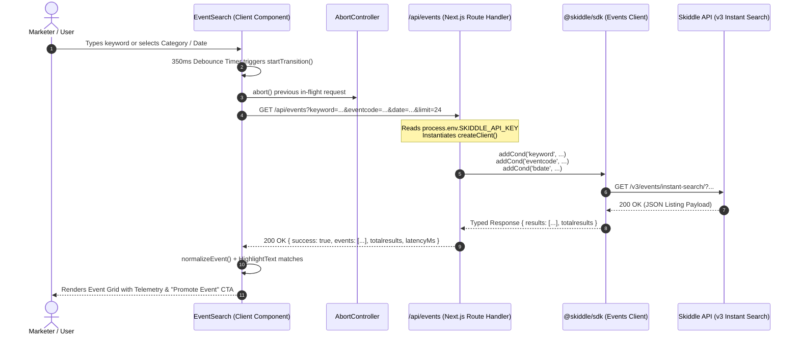

# 13 — Event Search, Multi-Facet Filtering & Real-Time Discovery Architecture

> **Document Version:** 1.0.0  
> **Topic:** Design, architecture, and implementation of the real-time `EventSearch` component, multi-facet filtering (keyword, event category, date), regex-safe keyword highlighting (`HighlightText`), Next.js 15 App Router REST endpoints (`/api/events`), in-flight request cancellation via native `AbortController`, and seamless promotion workflow integration.

---

## 🎯 Executive Overview & Strategic Importance

With the foundational JavaScript/TypeScript SDK (`@skiddle/sdk`), the NX° Developer Experience CLI (`@skiddle/cli`), and developer diagnostics established, the next milestone in the Skiddle ecosystem is delivering a **fast, resilient, end-user discovery interface** that bridges search listings with single-event promotion workflows.

The **Event Search & Discovery Architecture** (`apps/web/src/components/EventSearch/` and `apps/web/src/app/api/events/`) transforms raw Skiddle API listings into an interactive promotional discovery portal:

```
┌────────────────────────────────────────────────────────────────────────┐
│                        Next.js 15 Client Layer                         │
│  ┌──────────────────────────────────────────────────────────────────┐  │
│  │ EventSearch Component (React 19)                                 │  │
│  │ - 350ms Input Debounce with React 19 startTransition             │  │
│  │ - Multi-Facet Controls: Keyword, Event Category, Date            │  │
│  │ - In-Flight AbortController (Cancels Stale Network Requests)     │  │
│  │ - Safe Text Highlighting (HighlightText - Regex-escaped)         │  │
│  │ - Responsive Discovery Cards with Badges & Latency Telemetry     │  │
│  └──────────────────────────────────┬───────────────────────────────┘  │
└─────────────────────────────────────┼──────────────────────────────────┘
                                      │ fetch('/api/events?...', { signal })
                                      ▼
┌────────────────────────────────────────────────────────────────────────┐
│                   Next.js 15 Route Handler Runtime                     │
│  ┌──────────────────────────────────────────────────────────────────┐  │
│  │ GET /api/events (apps/web/src/app/api/events/route.ts)           │  │
│  │ - Server-Side SKIDDLE_API_KEY Resolution (Zero Client Leakage)   │  │
│  │ - Input Validation & Bounded Limit Clamping (1 - 50)             │  │
│  │ - Eliminates Browser Cross-Origin (CORS) Restrictions            │  │
│  │ - SkiddleException Error Trapping & Status Code Propagation      │  │
│  └──────────────────────────────────┬───────────────────────────────┘  │
└─────────────────────────────────────┼──────────────────────────────────┘
                                      │
                                      ▼
┌────────────────────────────────────────────────────────────────────────┐
│                      @skiddle/sdk Workspace Client                     │
│  ┌──────────────────────────────────────────────────────────────────┐  │
│  │ Fluent Condition Builder                                         │  │
│  │ client.events.addCond('keyword', keyword)                        │  │
│  │ client.events.addCond('eventcode', category)                     │  │
│  │ client.events.addCond('bdate', date)                             │  │
│  │ client.events.addCond('limit', limit)                            │  │
│  │ client.events.getListings()                                      │  │
│  └──────────────────────────────────┬───────────────────────────────┘  │
└─────────────────────────────────────┼──────────────────────────────────┘
                                      │ Native fetch (Node 18+)
                                      ▼
                      ┌───────────────────────────────┐
                      │    Skiddle API v3 / v1        │
                      │  https://api.skiddle.com/v3   │
                      │  https://www.skiddle.com/api  │
                      └───────────────────────────────┘
```

### Core Problems Solved

1. **Elimination of Keystroke Network Storms:** Users type rapidly. Without debouncing and request cancellation, every keystroke fires an API request, causing race conditions where an older, slower query overwrites a newer one. The search architecture combines a **350ms debounce**, React 19 `startTransition`, and native `AbortController.abort()` cancellation on in-flight requests.
2. **Strict Server Credential Isolation (Zero Client Leakage):** Browser clients never directly contact `api.skiddle.com` with API keys. Instead, the frontend calls the internal Next.js REST API route (`/api/events`), which initializes `@skiddle/sdk` on the server using `process.env.SKIDDLE_API_KEY`.
3. **CORS Policy Elimination:** Direct browser calls to third-party endpoints trigger browser CORS restrictions. Server-side proxying through Next.js Route Handlers eliminates CORS issues completely.
4. **Resilient Data Normalization (`normalizeEvent`):** The Skiddle API returns field names with slight casing variations (`eventName` vs `eventname`, `listingId` vs `id`, `startdate` vs `startDate`, nested `venue` objects). A deterministic normalization pipeline unifies these into a reliable `EventListItem` contract.
5. **Regex-Safe Substring Highlighting (`HighlightText`):** Searching with punctuation or regex characters (e.g., `[Special]`, `(Live)`, `*`) often crashes naive `new RegExp(query)` implementations. `HighlightText` escapes all special tokens before compilation and highlights matches safely.
6. **Direct Gateway to eFlyer Promotions:** Every card includes a "Promote Event →" action directing to `/events/[id]`, linking discovery seamlessly with the single event detail view and eFlyer campaign generator.

---

## 🏛 Component Architecture & Data Flow



---

## 🧩 Component Breakdown & Implementation Details

### 1. `EventSearch` (`apps/web/src/components/EventSearch/EventSearch.tsx`)

The main client component manages the interactive search experience with the following stateful controls:

- **Debounced Keystroke Handling:**
  ```typescript
  useEffect(() => {
    if (!keyword && !hasInteracted) return;

    const handler = setTimeout(() => {
      startTransition(() => {
        if (keyword) setHasInteracted(true);
        setDebouncedKeyword(keyword);
      });
    }, 350);

    return () => clearTimeout(handler);
  }, [keyword, hasInteracted]);
  ```

- **Network In-Flight Abort Controller:**
  ```typescript
  if (abortControllerRef.current) {
    abortControllerRef.current.abort();
  }
  const controller = new AbortController();
  abortControllerRef.current = controller;

  const response = await fetch(`/api/events?${params.toString()}`, {
    signal: controller.signal,
    headers: { Accept: 'application/json' },
  });
  ```

- **Clean Initial Render State (`hasInteracted`):**
  To avoid premature network calls, flashing empty states, or distracting error banners on first page load, searches only execute after the user performs an explicit interaction (typing a query, choosing a category, or selecting a date).

- **Multi-Facet Category Mapping:**
  Maps user-friendly labels to Skiddle API `eventcode` values:
  | Category Option | Skiddle `eventcode` | Description |
  | :--- | :--- | :--- |
  | All Categories | `all` | Global event catalog |
  | Live Music / Gigs | `LIVE` | Concerts, acoustic sets, indie/rock gigs |
  | Clubbing & DJ | `CLUB` | Electronic dance music, DJ nights, club events |
  | Festivals | `FEST` | Multi-day outdoor and indoor music festivals |
  | Comedy | `COMEDY` | Stand-up shows and comedic performances |
  | Theatre & Arts | `THEATRE` | Plays, musicals, cabaret, and dance |
  | Seasonal & Family | `SEASONAL` | Family-friendly, holidays, exhibitions |
  | Conferences & Talks | `CONF` | Technology talks, panels, educational events |
  | Sports & Fitness | `SPORT` | Matches, runs, boxing, fitness events |
  | Exhibitions | `EXHIB` | Art galleries, trade shows, cultural showcases |

- **Event Normalization Pipeline (`normalizeEvent`):**
  Defensively extracts data across disparate schema revisions:
  ```typescript
  export interface EventListItem {
    id: string | number;
    eventName: string;
    description: string;
    date: string;
    startDate?: string;
    venueName: string;
    venueTown: string;
    imageUrl: string;
    price: string;
    tickets: boolean;
    eventCode: string;
    genres: string[];
    raw: any;
  }
  ```

---

### 2. Regex-Safe Text Highlighting (`HighlightText.tsx`)

Located at `apps/web/src/components/EventSearch/HighlightText.tsx`. Naive implementations of text search highlighting using `new RegExp(query, 'gi')` crash when users input special regex characters such as `(`, `)`, `[`, `]`, `?`, `*`, `+`.

`HighlightText` eliminates this risk by sanitizing the query with an escaping pattern:

```typescript
// Escape special regex characters
const escaped = trimmedQuery.replace(/[.*+?^${}()|[\]\\]/g, '\\$&');
const regex = new RegExp(`(${escaped})`, 'gi');
const parts = text.split(regex);
```

Matching segments are rendered inside high-contrast `<mark>` tags:

```typescript
<mark
  key={index}
  style={{
    backgroundColor: '#fef08a',
    color: '#854d0e',
    padding: '1px 3px',
    borderRadius: '3px',
    fontWeight: 600,
  }}
>
  {part}
</mark>
```

---

### 3. Server Route Handlers (`/api/events` & `/api/events/[id]`)

Located at `apps/web/src/app/api/events/route.ts` and `apps/web/src/app/api/events/[id]/route.ts`.

#### Route Specification: `GET /api/events`

- **URL Query Parameters:**
  - `keyword` *(optional, string)*: Substring search across title, description, artist, and venue.
  - `eventcode` *(optional, string)*: Category code filter (e.g. `LIVE`, `FEST`, `CLUB`).
  - `date` *(optional, string)*: Bounded date filter formatted as `YYYY-MM-DD`. Mapped to SDK condition `bdate`.
  - `limit` *(optional, integer)*: Maximum results to return (clamped between 1 and 50, default: 24).

- **Implementation Highlights:**
  ```typescript
  export const dynamic = 'force-dynamic';

  export async function GET(request: NextRequest) {
    const { searchParams } = new URL(request.url);
    const keyword = searchParams.get('keyword') || '';
    const eventcode = searchParams.get('eventcode') || '';
    const date = searchParams.get('date') || '';
    const limit = Math.min(Math.max(parseInt(searchParams.get('limit') || '24', 10), 1), 50);

    const client = createClient({ apiKey: process.env.SKIDDLE_API_KEY, devMode: false });
    if (keyword.trim()) client.events.addCond('keyword', keyword.trim());
    if (eventcode && eventcode !== 'all') client.events.addCond('eventcode', eventcode);
    if (date.trim()) client.events.addCond('bdate', date.trim());
    client.events.addCond('limit', limit);

    const response = await client.events.getListings();
    // Return normalized JSON payload...
  }
  ```

- **Error Propagation:**
  Catches `SkiddleException` instances thrown by `@skiddle/sdk`, mapping HTTP error codes (e.g. 401 Unauthorized, 404 Not Found) directly to the JSON response with matching HTTP status codes.

---

## ⚡ Downstream Workflow: Promotion Gateway (`/events/[id]`)

When a user identifies an event in the search grid, clicking **"Promote Event →"** routes directly to `/events/[id]`.

This page connects the discovery tier to the single event detail and promotional asset pipeline documented in [11-event-detail-and-eflyer-schema.md](./11-event-detail-and-eflyer-schema.md):

1. **Server-Side Hydration:** `apps/web/src/app/events/[id]/page.tsx` executes `client.events.getListing(id)` during server rendering.
2. **Dynamic Promotion ViewModel:** The event data is converted to `EFlyerPromotionData` with door times, hex color badges, age restrictions, and full venue coordinates.
3. **Tri-Tab Promotion Inspector:**
   - **Structured View:** High-level promotional cards, pricing tiers, and venue information.
   - **eFlyer Preview:** Live email marketing flyer rendered with fallback imagery and Skiddle ticket links.
   - **Raw JSON Inspector:** Full API v1 payload with one-click clipboard copying.

---

## 🧪 Automated Testing & Verification

The search feature is guarded by unit tests in `apps/web/tests/unit/event-search.test.tsx` using Vitest:

| Test Group | Test Case | Target Behavior |
| :--- | :--- | :--- |
| **`HighlightText`** | `renders normal text without marks when query is empty` | Verifies `<span>Warehouse Project</span>` is rendered with zero `<mark>` tags. |
| **`HighlightText`** | `highlights matching term case-insensitively` | Verifies `The Warehouse Project Live` with query `"warehouse"` wraps `"Warehouse"` in `<mark>` elements. |
| **`HighlightText`** | `safely handles special regex characters in query string` | Verifies searching with `"[Special"` escapes brackets and matches safely without throwing `SyntaxError`. |
| **`HighlightText`** | `returns null gracefully when text is null or undefined` | Ensures passing `null` or `undefined` returns empty markup rather than throwing. |
| **`EventSearch Initial State`** | `does not render any events or results row before user interaction` | Confirms that on mount, the component displays the hero and filter inputs, but suppresses empty states, loading spinners, and result cards until user input. |

### Verification Command

```bash
# Run web unit tests specifically
pnpm --filter web test

# Run monorepo typecheck
pnpm typecheck
```
