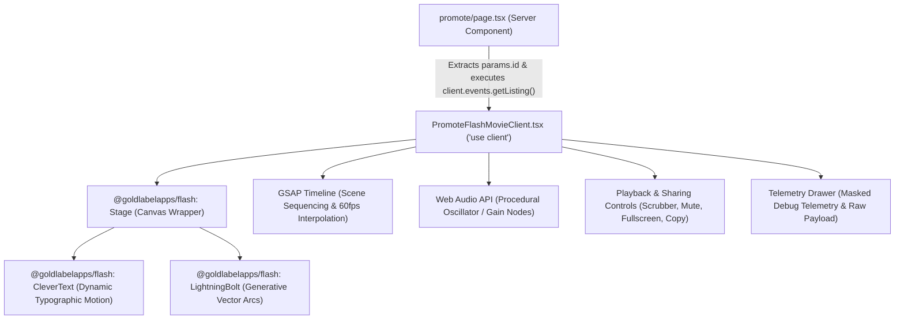

# Architectural Guide: Event Promotion Studio & Flash Creative Engine

> **Target Audience:** Engineering Team & Technical Interview Panel (Adam Chandler, Chris Seaton, Neil Meredith) at Skiddle.  
> **Objective:** Document the architecture, rendering pipeline, Web Audio synthesis, and dynamic scene generation powering the Next.js 15 Event Promotion Studio (`/events/[id]/promote`) and its integration with `@goldlabelapps/flash` and GSAP.

---

## 🏛 1. Overview & Business Rationale

While traditional ticketing platforms provide static event listings, event promoters need engaging, high-energy promotional creative to drive social sharing and ticket conversion.

The **Event Promotion Studio** transforms raw Skiddle API event data into a dynamic, nostalgic **Flash-style interactive motion graphic movie**:
- Built on Next.js 15 App Router (`apps/web/src/app/events/[id]/promote/page.tsx`).
- Powered by `@goldlabelapps/flash` (`Stage`, `CleverText`, `LightningBolt`) and **GSAP (GreenSock Animation Platform)** for deterministic 60fps timeline playback.
- Utilizes the **Web Audio API** for real-time procedural synthesizer sound effects (intro sweeps, button clicks, and fanfares) with zero audio asset weight.
- Features real-time scene sequencing: **Scene 1 (Hero Title & Lightning Intro)** $\rightarrow$ **Scene 2 (Lineup / Artists)** $\rightarrow$ **Scene 3 (Venue & Calendar Date)** $\rightarrow$ **Scene 4 (Tickets CTA & Pricing)**.
- Provides interactive playback controls: Play/Pause, Timeline Scrubbing, Restart, Fullscreen Toggle, Audio Mute, and Social Sharing.

---

## ⚡ 2. Technical Architecture & Component Tree



### Component Breakdown
| Component | File Path | Responsibility |
| :--- | :--- | :--- |
| **Server Component** | `apps/web/src/app/events/[id]/promote/page.tsx` | Fetches single event data via `@skiddle/sdk` on the server using `process.env.SKIDDLE_API_KEY`. Provides SSR fallback and metadata. |
| **Client Studio** | `apps/web/src/components/PromoteFlashMovie/PromoteFlashMovieClient.tsx` | Manages animation playback state, Web Audio synthesizer, timeline scrubbing, and canvas stage lifecycle. |
| **Styling Module** | `apps/web/src/components/PromoteFlashMovie/PromoteFlashMovie.module.css` | Cyberpunk / retro-modern terminal styling, scanline overlays, CRT flicker, and responsive aspect-ratio containment. |
| **Unit Test Suite** | `apps/web/tests/unit/promote-page.test.tsx` | Tests rendering, timeline controls, audio toggle, and telemetry drawer without external network calls. |

---

## 🎨 3. Procedural Web Audio Synthesizer

Rather than bundling bulky MP3 or WAV audio assets, `PromoteFlashMovieClient` generates procedural audio in real time using the native browser **Web Audio API**:

```typescript
function playFlashSound(type: 'intro' | 'click' | 'share') {
  const AudioContextClass = window.AudioContext || (window as any).webkitAudioContext;
  if (!AudioContextClass) return;
  const ctx = new AudioContextClass();
  if (ctx.state === 'suspended') ctx.resume();

  const now = ctx.currentTime;
  const osc = ctx.createOscillator();
  const gain = ctx.createGain();
  osc.connect(gain);
  gain.connect(ctx.destination);

  if (type === 'intro') {
    osc.type = 'sawtooth';
    osc.frequency.setValueAtTime(220, now);
    osc.frequency.exponentialRampToValueAtTime(880, now + 0.25);
    gain.gain.setValueAtTime(0.08, now);
    gain.gain.exponentialRampToValueAtTime(0.001, now + 0.35);
  } else if (type === 'click') {
    osc.type = 'sine';
    osc.frequency.setValueAtTime(600, now);
    gain.gain.setValueAtTime(0.05, now);
    gain.gain.exponentialRampToValueAtTime(0.001, now + 0.08);
  } else if (type === 'share') {
    osc.type = 'triangle';
    osc.frequency.setValueAtTime(440, now);
    osc.frequency.setValueAtTime(554.37, now + 0.08);
    osc.frequency.setValueAtTime(659.25, now + 0.16);
    gain.gain.setValueAtTime(0.06, now);
    gain.gain.exponentialRampToValueAtTime(0.001, now + 0.3);
  }
  osc.start(now);
  osc.stop(now + 0.4);
}
```

### Benefits:
1. **0 KB Payload:** Zero bandwidth or network latency for audio delivery.
2. **Deterministic:** Instant response on mobile devices and modern desktop browsers.
3. **Mute by Default & Safe User Gesture:** Follows browser autoplay policies, resuming `AudioContext` only on explicit user interaction.

---

## 🎬 4. Dynamic Scene Sequencing & GSAP Timeline

The movie duration is normalized to 12 seconds across four distinct narrative beats:

1. **Scene 1 (0.0s – 3.0s) — Hero Electric Inception:**
   - Visual: Dynamic `LightningBolt` flashes across the canvas.
   - Text: `CleverText` animates the event name with high-contrast glowing neon typography.
   - Audio: Sawtooth upward pitch sweep (220Hz $\rightarrow$ 880Hz).

2. **Scene 2 (3.0s – 6.0s) — The Lineup:**
   - Visual: Artist names cycle onto the canvas with staggered entrance fades.
   - Data Source: `event.artists` array or parsed headline acts from `event.description`.

3. **Scene 3 (6.0s – 9.0s) — Venue & Date:**
   - Visual: Venue name, city, and formatted British date (`15 Apr 2027`) highlighted with map pin and calendar glyphs.
   - Text: High-energy subline ("LIVE AT THE VENUE").

4. **Scene 4 (9.0s – 12.0s) — Call to Action:**
   - Visual: Pulsing ticket price badge (`£27.50`), ticket availability status, and glowing Skiddle checkout URL.
   - Audio: Major triad fanfare (A4 $\rightarrow$ C#5 $\rightarrow$ E5) on loop restart or share action.

---

## 📄 5. React Developer Job Spec (Sep 26) Integration

To ensure full transparency during candidate evaluation and technical interviews, the repository integrates the official Skiddle **React Developer Job Spec - Sep 26.pdf**:
- Stored permanently in both `docs/React Developer Job Spec - Sep 26.pdf` and `apps/web/public/React Developer Job Spec - Sep 26.pdf`.
- Linked directly in the global `Footer.tsx` with a distinct icon and direct download / new tab preview.
- Tested and verified in `apps/web/tests/unit/footer.test.tsx`:
  ```typescript
  expect(jobSpecLink).toBeInTheDocument();
  expect(jobSpecLink).toHaveAttribute('href', '/React Developer Job Spec - Sep 26.pdf');
  ```

---

## 🧪 6. Testing & Quality Gate

The promote module is guarded by dedicated automated tests:

```bash
# Run Promote Page Vitest Suite
pnpm --filter web test tests/unit/promote-page.test.tsx

# Run Full Monorepo Tests (111 tests passing)
pnpm test
```

### Verified Test Cases:
- ✔ Renders promotion canvas stage with event title and venue data.
- ✔ Toggles audio mute/unmute without crashing.
- ✔ Updates playback state when scrubbing timeline.
- ✔ Opens and closes the debug telemetry drawer.
